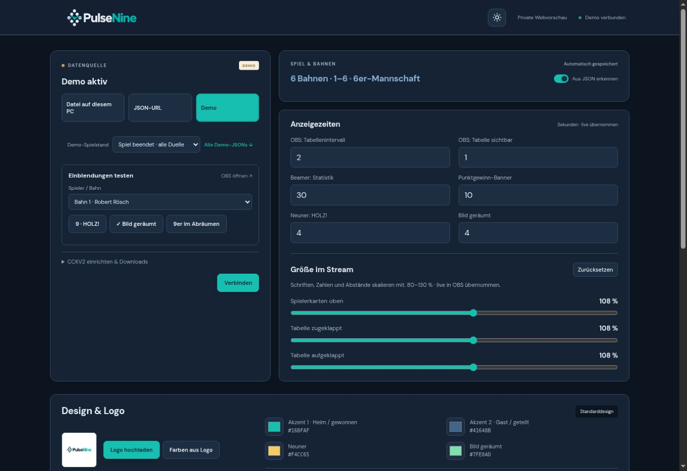
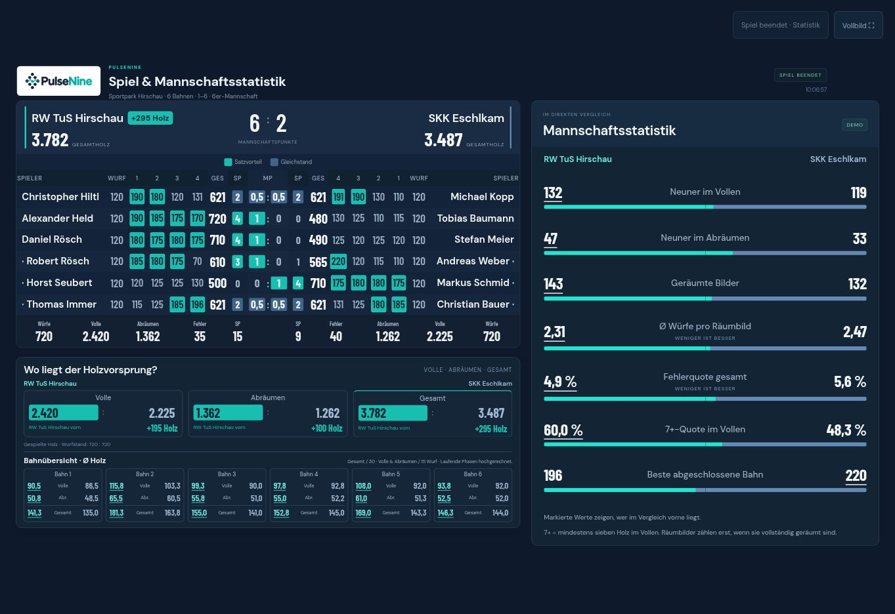
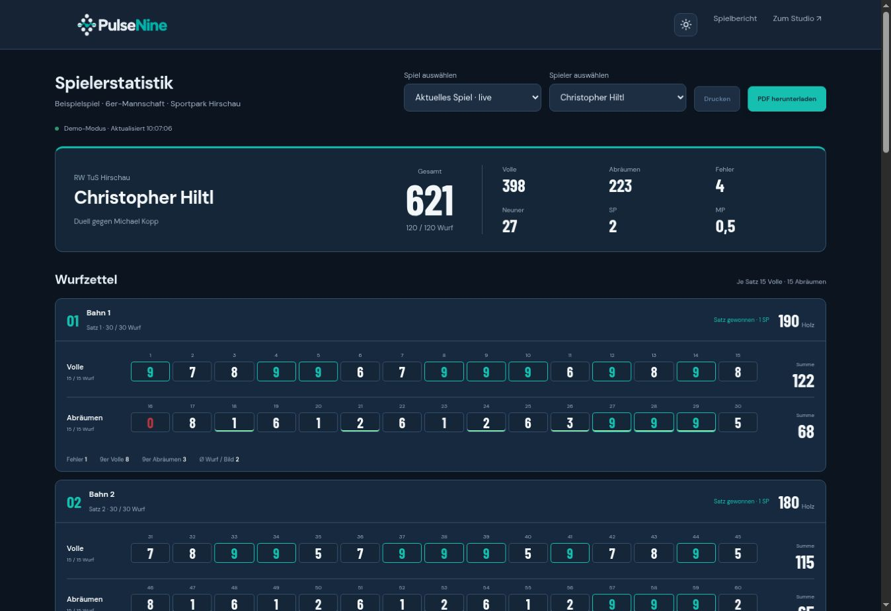

# PulseNine

**Live. Bahn. Statistik.**

PulseNine bündelt den Spielstand aus CCKV2 und macht daraus eine gemeinsame Grundlage für den Livestream, die Anzeige auf der Kegelbahn und die Auswertung nach dem Spiel. Das Studio steuert alle Ausgaben an einer Stelle.

[Neueste Windows-Version herunterladen](https://github.com/safredAAs/pulsenine-releases/releases/latest)

## Was PulseNine kann

| Bereich | Funktionen |
| --- | --- |
| **Studio** | Lokale CCKV2-JSON oder JSON-URL verbinden, Mannschaftsgröße und Bahnbelegung automatisch erkennen, Anzeigezeiten und OBS-Größen einstellen. |
| **Livestream / OBS** | Transparente Browser-Ausgabe mit gespiegelten Duellkarten, aktueller Bahnleistung, Gesamtholz, SP und live berechneten MP. Die Tabelle wechselt zwischen kompakter und ausgeklappter Ansicht. |
| **Beamer / Bahnausgabe** | Gut lesbare Spielübersicht, Mannschaftsvergleich, Bahnübersicht und Statistiken für Zuschauer vor Ort. |
| **Spielerstatistik** | Wurfzettel mit jedem Wurf, getrennt nach Volle und Abräumen je Bahn, Summen, Duellvergleich und Holzverlauf. |
| **Spielbericht** | Gespiegelte Gegenüberstellung beider Mannschaften, Einzelpaarungen, Mannschaftsstatistiken und Holzverlauf. Mannschaftsbeste werden hervorgehoben. |
| **Drucken & PDF** | A4-Ausgabe für Spieler und Spielbericht: Bericht auf der ersten Seite, ergänzende Statistiken auf der zweiten. Die Druckausgabe bleibt hell. |
| **Spielarchiv** | Spielstände lokal sichern und frühere Spiele für Statistiken und Berichte wieder aufrufen. |
| **Vereinsdesign** | Eigenes Vereinslogo für die Ausgaben hochladen, Farben daraus ableiten oder manuell anpassen. Das PulseNine-Logo im Studio bleibt erhalten. |
| **Demo-Modus** | Mehrere Spielstände ausprobieren, einschließlich Satzende, Duellende, Unentschieden und Spielende. Neuner- und Räum-Einblendungen lassen sich gezielt testen. |
| **Updates** | Ab 2.2.0 prüft die installierte Windows-Anwendung beim Start auf neue stabile Versionen. Nach Bestätigung folgen Download, Prüfsummenkontrolle, Installation und Neustart. |

## Ein Blick in die Anwendung

Die folgenden Screenshots zeigen den Demo-Modus. Namen und Ergebnisse dienen als Beispieldaten.

### Ein Studio für die Übertragung

Datenquelle verbinden, Ausgaben öffnen und die Darstellung vor Ort anpassen. Die Größen von Karten sowie kompakter und ausgeklappter Tabelle lassen sich unabhängig einstellen; Schriften und Abstände skalieren mit.

### Spiel und Mannschaft auf dem Beamer

Spielstand, Paarungen, Volle-/Abräumvergleich und Bahnwerte bleiben gemeinsam sichtbar.

### Jeder Wurf im Spielerbericht

Die Einzelwürfe sind nach Bahn und Spielphase aufgeteilt. Neuner und geräumte Bilder sind im Wurfzettel erkennbar.

## Installation und erster Start

1. Unter [Releases](https://github.com/safredAAs/pulsenine-releases/releases/latest) die Datei **PulseNine_Setup.exe** aus dem Bereich **Assets** herunterladen.
2. Für ein Update PulseNine schließen und den bisherigen Installationsordner verwenden. Lizenz, Einstellungen und Spielarchiv liegen getrennt vom Programm und bleiben erhalten.
3. PulseNine mit einer gültigen Vereinslizenz aktivieren. Ein öffentlicher Download aktiviert die Anwendung nicht.
4. Im Studio zunächst den Demo-Modus testen oder die von CCKV2 erzeugte JSON-Ausgabe verbinden.
5. Die im Studio angezeigte OBS-Adresse als Browserquelle in OBS einfügen beziehungsweise die Beamer- oder Statistikansicht öffnen.

**Voraussetzungen:** Windows 10/11 mit 64 Bit. Für die Live-Anbindung wird eine passende JSON-Ausgabe aus CCKV2 benötigt. CCKV2 ist nicht Teil dieses Downloads.

Welche Detailstatistiken angezeigt werden können, hängt vom Export ab. Für Wurfzettel, Holzverläufe und Räumbild-Auswertungen müssen die entsprechenden Einzelwürfe vorhanden sein. Fehlende Informationen werden nicht durch erfundene Werte ersetzt.

## Updates

In der installierten Windows-Version ab 2.2.0 erfolgt die Prüfung beim Programmstart oder über **Hilfe → Nach Updates suchen**. Ein verfügbares Update wird erst nach Bestätigung heruntergeladen und installiert. PulseNine wird dabei geschlossen und anschließend neu gestartet. Ohne Internet lässt sich das Programm weiter verwenden.

Wer bisher 2.1.2 oder älter nutzt, installiert die erste Version mit Updatefunktion einmal manuell. Portable-Versionen werden manuell aktualisiert.

Die Downloads sind derzeit nicht digital signiert. Die SHA-256-Prüfsumme steht am jeweiligen Release-Asset und in **SHA256SUMS.txt**.

## Lizenz und Download-Repository

Dieses Repository enthält Produktinformationen, Screenshots und freigegebene Installationsdateien. Der Anwendungsquellcode und der Lizenzmanager sind privat. Die Nutzung von PulseNine erfordert eine gültige Vereinslizenz, die an den aktivierten PC gebunden ist.

Die von GitHub automatisch angebotenen **Source code (zip/tar.gz)**-Archive enthalten nur dieses öffentliche Download-Repository. Sie sind keine PulseNine-Installationspakete.
